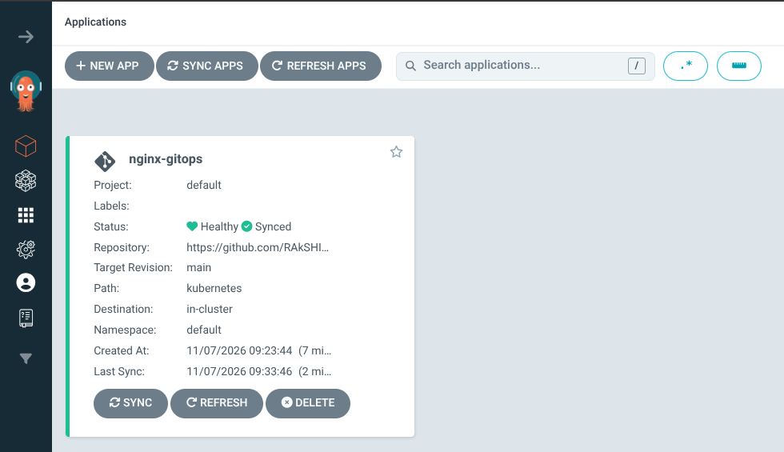
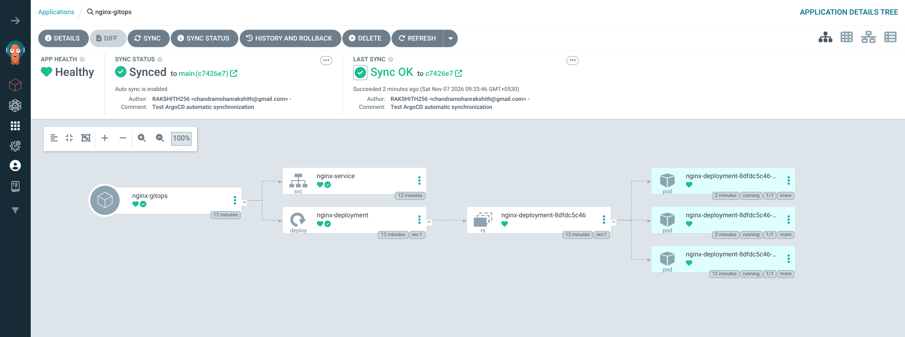

# GitOps Workflow Using ArgoCD and Kubernetes


## Overview

A hands-on GitOps project demonstrating automated Kubernetes deployment using **ArgoCD, Kind, and GitHub**.

ArgoCD continuously monitors the GitHub repository and automatically synchronizes Kubernetes resources whenever configuration changes are pushed.

The project also demonstrates automated self-healing, restoring the desired cluster state after manual changes.

## Architecture

```text
Developer → GitHub → ArgoCD → Kubernetes (Kind) → NGINX
                         |
                   Auto Sync
                   Self-Healing
```

## Technologies

- Fedora Linux
- Docker
- Kind (Kubernetes in Docker)
- Kubernetes
- ArgoCD
- Git and GitHub
- NGINX

## Project Structure

```text
argocd-gitops-project/
├── argocd/
│   └── application.yaml
├── kubernetes/
│   ├── deployment.yaml
│   └── service.yaml
├── screenshots/
│   ├── argocd-dashboard.png
│   └── argocd-application-details.png
└── README.md
```

## Key Features

- **Automated Synchronization:** ArgoCD automatically deploys changes pushed to GitHub.
- **Self-Healing:** Automatically restores the desired state when live Kubernetes resources are manually modified.
- **Automatic Pruning:** Removes resources deleted from the Git repository.
- **Declarative Deployment:** Kubernetes resources are managed using YAML manifests.
- **Health Monitoring:** ArgoCD monitors application health and synchronization status.

## Screenshots

### 1. ArgoCD Dashboard



### 2. ArgoCD Application Details



The application successfully reached **Healthy** and **Synced** status, with all three NGINX pods running.

## Deployment and Verification

Clone the repository:

```bash
git clone https://github.com/RAkSHITH256/argocd-gitops-project.git
cd argocd-gitops-project
```

Apply the ArgoCD application:

```bash
kubectl apply -f argocd/application.yaml
```

Check application status:

```bash
kubectl get application nginx-gitops -n argocd
```

Check Kubernetes resources:

```bash
kubectl get pods
kubectl get deployments
kubectl get services
```

Access NGINX locally:

```bash
kubectl port-forward svc/nginx-service 8086:80
```

Open: http://localhost:8086

## Self-Healing Test

Manually scale the deployment down:

```bash
kubectl scale deployment nginx-deployment --replicas=1
```

ArgoCD detects the configuration drift and automatically restores the deployment to three replicas.

Verify:

```bash
kubectl get deployment nginx-deployment
kubectl get application nginx-gitops -n argocd
```

Expected status: **3/3 replicas, Synced, Healthy.**

## GitHub Repository

[RAkSHITH256/argocd-gitops-project](https://github.com/RAkSHITH256/argocd-gitops-project)

---

**Author:** [RAkSHITH256](https://github.com/RAkSHITH256)

*Demonstrating GitOps, Kubernetes automation, continuous synchronization, and self-healing infrastructure.*
